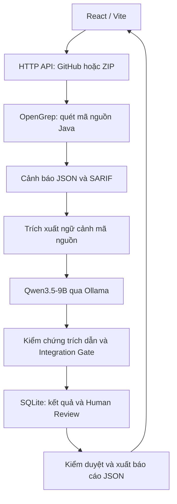

# Phát triển công cụ phát hiện lỗ hổng mã nguồn kết hợp phân tích tĩnh nguồn mở và mô hình ngôn ngữ lớn

Đồ án tốt nghiệp ngành Công nghệ thông tin, Trường Đại học Công nghệ, Đại học Quốc gia Hà Nội.

Công cụ phân tích mã nguồn Java bằng OpenGrep, sau đó sử dụng Qwen3.5-9B để đánh giá từng cảnh báo dựa trên ngữ cảnh mã nguồn. Mô hình chạy cục bộ qua Ollama. Người dùng xem kết quả phân tích, kiểm tra trích dẫn, xác nhận cảnh báo và xuất báo cáo trên giao diện web.

## Phạm vi nghiên cứu

Đồ án tập trung vào hai nhóm lỗ hổng:

- CWE-22 (Path Traversal): truy cập tệp hoặc thư mục ngoài phạm vi cho phép do xử lý đường dẫn không an toàn.
- CWE-89 (SQL Injection): dữ liệu đầu vào làm thay đổi cấu trúc truy vấn SQL ngoài ý muốn.

Bộ demo tham chiếu còn có mẫu CWE-78 và CWE-79, nhưng hai nhóm này nằm ngoài phạm vi thực nghiệm chính. Luồng phân tích hiện hành không gửi mã nguồn cần quét lên dịch vụ suy luận LLM đám mây.

## Kiến trúc và quy trình phân tích

Backend tiếp nhận mã nguồn, chạy OpenGrep, lấy ngữ cảnh Java cho mô hình và kiểm chứng kết quả. Frontend kết nối qua HTTP API để theo dõi tiến trình, xem cảnh báo và thực hiện kiểm duyệt.

Đối với mỗi cảnh báo, hệ thống kiểm tra đường dẫn tệp, số dòng, nội dung trích dẫn và mã băm SHA-256. Kết quả từ mô hình được lưu tách biệt với nhận định sau kiểm chứng và quyết định của người dùng.

| Nhận định | Ý nghĩa |
| --- | --- |
| `SUPPORTED` | Có bằng chứng hỗ trợ nhận định về cảnh báo. |
| `REFUTED` | Có bằng chứng phản bác cảnh báo. |
| `UNDETERMINED` | Chưa đủ căn cứ để kết luận. |

Đây là các nhận định của hệ thống, chưa phải nhãn TP hoặc FP. Trích dẫn khớp với mã nguồn cũng chưa đủ để khẳng định cảnh báo đúng hay sai. Cảnh báo `REFUTED` vẫn ở trạng thái `OPEN` cho đến khi người dùng quyết định. Trước khi xác nhận cảnh báo giả (`CONFIRMED_FALSE`), API kiểm tra lại SHA-256 của tệp và trả `409 STALE_SOURCE` nếu mã nguồn đã thay đổi. Hệ thống lưu lịch sử kiểm duyệt, kể cả quyết định bị từ chối.

## Phần kế thừa và phần phát triển thêm

Đồ án kế thừa [simple_semgrepAI](https://github.com/hardw00t/simple_semgrepAI/tree/2c79a58a16d11e9dea3723e30d2a7faffba7bdc9), phiên bản 0.2.0. Phần mã kế thừa, bản vá chuyển sang OpenGrep và bằng chứng nhiệm vụ ban đầu nằm trong `v2/baseline/`. Giấy phép MIT của [upstream](v2/baseline/upstream/LICENSE) và [fork](v2/baseline/fork/LICENSE) được giữ nguyên.

Phần phát triển thêm gồm luồng phân tích cảnh báo Java bằng Qwen chạy cục bộ, kiểm chứng trích dẫn dựa trên mã nguồn, kiểm tra thay đổi tệp trước khi xác nhận cảnh báo giả và lưu lịch sử kiểm duyệt. Prompt không được cung cấp nhãn Ground Truth. Giao diện web kết nối các chức năng này thành một quy trình quét và kiểm duyệt.

## Cấu trúc mã nguồn

| Thư mục | Nội dung |
| --- | --- |
| [`v2/baseline/`](v2/baseline/) | Mã kế thừa, luật demo và hồ sơ nhiệm vụ ban đầu |
| [`v2/triage/`](v2/triage/) | Phân tích ngữ cảnh, suy luận và kiểm chứng bằng chứng |
| [`v2/api/`](v2/api/) | HTTP API và luồng quét, phân tích, kiểm duyệt |
| [`v2/g1_integration/`](v2/g1_integration/) | Tích hợp CLI, demo và tài liệu kiểm chứng |
| [`v2/g1_audit/`](v2/g1_audit/), [`v2/g1_runtime/`](v2/g1_runtime/) | Kiểm toán và kiểm thử biên nhận runtime |
| [`apps/22025523-thesis/`](apps/22025523-thesis/) | Giao diện React/Vite |
| [`docs/`](docs/) | Tài liệu tiến độ và quy trình cập nhật mã nguồn |

## Hướng dẫn cài đặt và sử dụng

Môi trường vận hành đã ghi nhận vào tháng 11/2026 sử dụng Python 3.11.9, OpenGrep 1.25.0, Ollama 0.40.7 và model `qwen3.5:9b-q4_K_M`. Bộ mã tham chiếu của giảng viên sử dụng OpenGrep 1.33.1 và Ollama 0.40.16. Kết quả trên hai môi trường cần được phân biệt khi đối chiếu.

Khi thiết lập môi trường mới, xem hướng dẫn cho từng thành phần:

- [Backend HTTP API](v2/api/README.md): cấu hình OpenGrep, Ollama và xác thực API.
- [Frontend React/Vite](apps/22025523-thesis/README.md): yêu cầu Node.js 20+, npm và cách kết nối API.
- [Luồng CLI kế thừa](v2/baseline/README.md) và [tài liệu tích hợp](v2/g1_integration/README.md): hướng dẫn tái lập và các giới hạn hiện có.

API token chỉ nhập qua giao diện trong phiên làm việc, không đặt trong biến `VITE_*` hoặc commit vào Git. Không dùng hướng dẫn dành cho môi trường mới để khởi động lại hệ thống đang chạy.

## Kết quả hiện tại

Mã nguồn backend và frontend được đồng bộ lên `main` tại commit [`c5a778a`](https://github.com/TuanKhoa1201/22025523-NTK-UET-Thesis/commit/c5a778a4cf198d8edabd3f9582431536400b4af6) ngày 27/11/2026. Hệ thống đã được chạy thử qua API và Chrome, với các bước quét repository GitHub, phân tích cảnh báo, kiểm chứng bằng chứng, kiểm duyệt và xuất báo cáo.

Pha nghiệm thu vận hành nội bộ được chấp nhận có giới hạn (`ACCEPTED_WITH_LIMITATIONS`). Kết quả thực nghiệm đối chứng chưa chứng minh được khả năng giảm cảnh báo giả. G3 còn `PARTIAL`, việc đóng băng holdout chưa được chứng minh đầy đủ và G4 chưa được nghiệm thu theo cổng chính thức (`NOT_TESTED`).

Tại commit mã nguồn `c5a778a`, hai workflow CI đạt và workflow kiểm tra nền tảng OpenGrep thất bại ở luồng CLI R03. Người vận hành đã chấp thuận công bố mốc mã nguồn với giới hạn này. Lỗi CLI vẫn chưa được xử lý. Xem [kết quả CI thất bại](https://github.com/TuanKhoa1201/22025523-NTK-UET-Thesis/actions/runs/45990840614/job/140477975871) và [số liệu kiểm chứng, giới hạn nghiên cứu](docs/trang-thai-hien-tai.md).

## Lịch sử phát triển

Nhánh `main` lưu mã nguồn hiện hành. Bản sao lịch sử tại [Thesis-History](https://github.com/TuanKhoa1201/Thesis-History) gồm 127 commit khác nhau, 5 nhánh và 1 tag, đã được kiểm tra bằng cách clone lại từ GitHub ngày 27/11/2026. Repository lưu trữ ở chế độ Private; giảng viên cần được cấp quyền truy cập nếu muốn xem.

| Nhánh cũ | Commit trong bản lưu trữ |
| --- | --- |
| `history/legacy-thesis-20261114` | [`78012d08`](https://github.com/TuanKhoa1201/Thesis-History/tree/78012d08deb0075b57f6d099338f1d77b58ddaf0) |
| `v2/antigravity-review` | [`cc9c4c9f`](https://github.com/TuanKhoa1201/Thesis-History/tree/cc9c4c9facfb0d418a33c786f7591c680492fc9a) |
| `v2/codex-core` | [`a099ac67`](https://github.com/TuanKhoa1201/Thesis-History/tree/a099ac670bc3c18996d47063dfee266fcde6a9d0) |
| `v2/javis-benchmark` | [`4de45981`](https://github.com/TuanKhoa1201/Thesis-History/tree/4de45981cd83dcada56186d707fe9f11609ed006) |

Các tên nhánh trong hồ sơ cũ có thể được tra cứu qua commit tại repository lưu trữ. Bản sao này bảo toàn lịch sử Git tại thời điểm sao lưu, không bao gồm toàn bộ dữ liệu vận hành. Bốn nhánh cũ trên repository chính chỉ được xóa sau khi kiểm tra lại bản sao và được người vận hành phê duyệt. Tag lịch sử được giữ nguyên.

Quy định phát triển: [AGENTS.md](AGENTS.md) và [quy trình cập nhật GitHub](docs/quy-trinh-cap-nhat-github.md).
