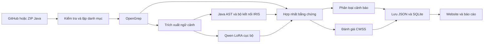

# Kiến trúc hệ thống đồ án

## Mục tiêu

Hệ thống phát hiện và ưu tiên các điểm yếu trong mã nguồn Java bằng cách kết hợp phân tích tĩnh, bằng chứng về luồng dữ liệu và mô hình ngôn ngữ cục bộ. Phạm vi bộ quy tắc hiện tại gồm CWE-22, CWE-78, CWE-79 và CWE-89. Không khẳng định bao phủ mọi lỗi bảo mật.

## Các thành phần

1. **Frontend React/Vite**: nhận URL GitHub hoặc ZIP mã Java, hiển thị tiến trình, tổng hợp kết quả, bằng chứng, mức ưu tiên, lịch sử và Data Explorer.
2. **OpenGrep OSS**: tạo ứng viên từ bộ quy tắc Java trong `backend/ntk-production-v2/rules/`. Rule match không tự chứng minh lỗ hổng thực tế.
3. **Java AST và IRIS**: sử dụng `JavacTask` (JDK 17) để tìm ngữ cảnh, đối chiếu source, sink, luồng dữ liệu và điều kiện bảo vệ. Bộ kết nối IRIS gốc có chế độ riêng dựa trên CodeQL, cần upstream, giấy phép và cấu hình. Mặc định dùng Java AST dự phòng, không đồng nhất với chạy IRIS gốc.
4. **Qwen LoRA cục bộ**: model `Qwen2.5-Coder-0.5B-Instruct` với adapter tinh chỉnh, phân loại API vào `source`, `sink`, `taint-propagator`, `none`. Đây là phân loại vai trò API, không phải trực tiếp dự đoán TP/FP.
5. **Tổng hợp bằng chứng và triage**: kết hợp các tín hiệu có nguồn gốc để xác định `REPORT`, `REVIEW`, `SUPPRESS`. Trường hợp thiếu chứng cứ phải giữ trạng thái chưa đủ cơ sở thay vì tự suy đoán an toàn.
6. **Chấm điểm CWSS**: triển khai MITRE CWSS 1.0.1 với 16 metric. Phải phân biệt metric suy ra từ mã, metric chưa rõ và metric được gán theo kịch bản tham chiếu; điểm không phải xác suất đúng/sai.
7. **Lưu kết quả**: REST API trả summary, phân trang findings, telemetry và Dataset Explorer. Kết quả được lưu bằng JSON và chỉ mục SQLite cục bộ.

## Quy trình 10 giai đoạn

| Bước | Nội dung |
|---|---|
| 01 | Tiếp nhận dự án GitHub hoặc ZIP |
| 02 | Lập danh mục file Java và kiểm tra giới hạn |
| 03 | OpenGrep phát hiện ứng viên |
| 04 | Trích xuất ngữ cảnh mã nguồn |
| 05 | Phân tích Java AST, bằng chứng IRIS nếu được cấu hình |
| 06 | Qwen LoRA phân loại vai trò API |
| 07 | Hợp nhất tín hiệu, kiểm tra xung đột bằng chứng |
| 08 | Xác định điểm ưu tiên dựa trên dữ liệu và kịch bản |
| 09 | Phân loại REPORT, REVIEW, SUPPRESS |
| 10 | Lưu, lập chỉ mục và trình bày báo cáo |

Phân tích AST có giới hạn phạm vi; không được diễn giải thành kiểm chứng đầy đủ luồng dữ liệu giữa mọi module, mọi thư viện và mọi dịch vụ.

## Huấn luyện và vận hành

- **Giai đoạn huấn luyện**: dùng bộ dữ liệu Java API role có nguồn gốc, kiểm tra trùng lặp, tách train/dev/holdout, tinh chỉnh LoRA và lựa chọn checkpoint.
- **Giai đoạn vận hành**: dùng checkpoint được chọn để suy luận cục bộ cho ngữ cảnh ứng viên; đối chiếu với bằng chứng từ công cụ tĩnh và phân tích chương trình.

Checkpoint và dataset được quản lý riêng, không phát hành kèm mã nguồn. Kết quả đánh giá API role không được coi là kết quả đánh giá phát hiện lỗ hổng toàn hệ thống.

## Sơ đồ dữ liệu

## Triển khai và giới hạn tin cậy

Frontend chạy trong trình duyệt trên Windows, backend chạy trong WSL2 Ubuntu và dùng địa chỉ localhost. Mã nguồn Java từ GitHub có thể cần mạng để tải; việc suy luận mô hình không gửi mã nguồn cho dịch vụ LLM đám mây. Không mở REST API cho máy khác khi chưa bổ sung xác thực và kiểm soát tải.

Tham khảo `docs/chay-tren-may-khac.md`, `research/scoring_v1_2.md`, `evaluation/bao-cao-kiem-thu-da-xac-minh.md`.
